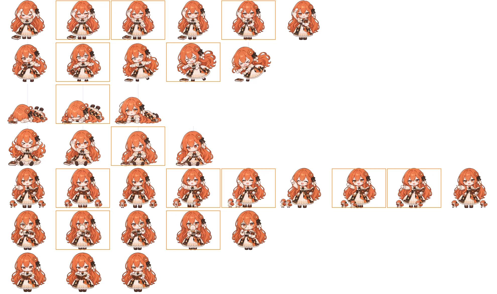

# 中间帧（衔接图）· 已补帧的八套

2026-11-07。碰边一套和工作状态一套之前补过帧，但翻页是硬切的，相邻两张动作差得大时看着一跳一跳。用户定：已经补过帧的继续加中间帧，没补过的（生气一串、累了等）不做；全权交给 Claude，最后审核。

（每行是一套，按播放顺序排；橙框是新加的中间帧，循环的几套最后一格是回到开头。）

## 帧表（character.json 的 frames）

| 姿态 | 新的播放顺序 | 每张停留（毫秒） | 总长（原来） |
|---|---|---|---|
| bonk 撞头 | bonk → **m0** 头抬到一半 → **m1** 一只手放下 → bonk-2 → **m2** 捡起书往胸前拿 → bonk-3 | 450、100、120、480、200、停住 | 1350（1250） |
| stagger 站不稳 | stagger → **m1** 晃回正中、书要掉了 → stagger-2 → **m2** 往前倾、手乱挥 → stagger-3 | 300、150、300、150、停住 | 900（900） |
| faceplant 趴地 | faceplant → **m1** 刚开始撑起 → faceplant-2 | 600、200、停住 | 800（800） |
| fallen 摔倒 | fallen-1 → fallen → **m1** 手放下、伸向书 → fallen-2 | 300、700、200、停住 | 1200（1200） |
| delegating 派活（循环） | delegating → **m1** → delegating-2 → **m2** → **m2b** → delegating-3 → **m3** → **m3b** | 1600、150、1400、120、120、1100、120、120 | 4730（4700） |
| searching 查资料（循环） | searching → **m1** 放大镜在脸前正中 → searching-2 → **m1** | 1550、150、1550、150 | 3400（3400） |
| reading 看书（循环） | reading → reading-2（第五轮起，见下） | 2400、900 | 3300（3300） |

- 摔倒第一下着地（fallen-1，300 ms）本来就快，不加。
- 碰边各段时长（`web/tumble.js` 的 `STEPS`）没改，翻完都还留 300 ms 以上停在最后一张。
- 有火气时撞头停在 bonk-2（揉头、泛泪），不演 bonk-m2、bonk-3（捡书、笑），再淡入到生气（见 `index.html` 的 `tumbleStep`）。

## 第二轮（用户第一次审核之后）

用户反馈：撞头不顺、有事问你的头像鬼突然扭头、派活首尾接不上、看书有人物缩放。用户说有问题的不一定重画，可以继续补衔接图，怎么判断交给 Claude。Claude 的判断：动作跨度大但每张画得对，就补帧；中间帧本身画错了（会多出一种头、没画在半路上），就重画。

- **缩放感（看书、撞头等站着的五套）**：Codex 每张画的身长不一样，按脚贴地摆放时头顶上下跳十几到二十像素（看书一圈 19 → 10 → 0）。站着的五套（撞头、有事问你、派活、查资料、看书）改成按头顶对齐重算缩放（`build/codex-imagegen/crown.py`），同一套里头顶差不超过 2 像素、头的大小差 2–3%。坐着、趴着的三套没改。现有立绘因此重新处理了 19 张，旧的备份在本机 `build/旧立绘备份-中间帧对齐前/`（有 SHA256）。
- **有事问你**：第一版三张中间帧的头和底图不是同一个头，一来一回晃三下。重画时锁定头、脸、头发和花饰和底图一样，只动手和书；用眼睛模板量过，和底图重合（`eyes.py`，匹配 0.83–0.96）。原有的 asking-2、asking-3 眼睛比底图高 14–16 像素、头画大了，按眼睛高度对齐一半（缩小约 1.7%，全对齐身子会矮一截），切换时脸只跳 6–8 像素。
- **派活首尾**：第一版 m3 几乎画成了终点那张（手已经指出去、分身已经回到两边），m2 里右边的分身直接跳到了左边。重画这两张，并各补一张（m2b、m3b），让手一点点举起、放下，分身从右边经过她脚前走到左边再走回去。
- **撞头**：第一张缩着脖子、抱头，m1 的头已经抬起来了，这一段在一帧里完成。补一张 bonk-m0（头抬到一半、双手还在头上、眼睛半睁）。

## 第三轮：有事问你不歪头

用户：「有事问你」重新设计，不要歪头（看着诡异）。asking-2（指左页）、asking-3（指右页）按底图 asking 重画：头、脸、头发、花饰和底图一样，不歪头，只用手指书页、眼神往下看（提示词 `047`、`048`；附图 3 是底图，附图 4 是旧图、只看手怎么指）。和已经锁过头的三张中间帧、挥手的 asking-4 一起，整套一圈头都不歪了。这两张画得比底图略高，放大到眼睛完全对齐会顶出画布，所以眼睛比底图低 8 像素左右（低头看书的幅度）。旧图在本机 `build/codex-imagegen/out/asking-2.old.png`、`asking-3.old.png`。

## 第四轮：有事问你的眼睛和书

用户：还是很奇怪，主要在眼睛上，书本大小也变了。原因：几张都是 Codex 分别画的，眼形、瞳孔方向每张都不一样；原底图的书举得高、有点斜，变化帧的书放低放平了一截，翻页时书上下跳。这轮不再只靠提示词约束，改成合成保证一致（`scripts/prepare-sprites.py` 的 `HEAD_FROM`、`COMPOSE`）：

- 四张变化帧（左手抬起 / 指左页 / 右手抬起 / 指右页，提示词 `049`–`052`）让 Codex 把底图当作要修改的那张、只动一只手。
- 处理完后把原底图领口以上（头、脸、眼睛、头发、花饰）原样贴到每张上，按眼睛那一块对齐，领口处 10 像素渐变。
- 底图改成拼的：左半边取右手抬起那张（左手托着书边）、右半边取左手抬起那张（右手托着书边），书脊处渐变，拼完再贴一次原底图的头。这样一整圈书的位置、大小一样，眼睛一样（相差不超过 2 像素），只有手在动。
- 挥手两张（asking-4、asking-m4）书换成了合上的另一本，对不上，从循环里拿掉；asking-4 的旧图备份在本机 `build/旧立绘备份-中间帧对齐前/asking-4.第四版前.webp`。
- 循环：asking → m2 → asking-2 → m2 → asking → m3 → asking-3 → m3，每张 1700、150、1300、150、1500、150、1300、150 毫秒。

## 第五轮：有事问你去掉翻页、看书统一大小

- **有事问你**：用户定，不要翻页动作了。只留一张静态图 `asking`（原来那张底图），四张变化帧、贴头和拼底图都去掉（`HEAD_FROM`、`COMPOSE` 现在空着，留给以后用）。
- **看书**：用户说每张人物大小不一样。原底图 `reading`（fdca2cd3…_720）是早一轮画的，头和头发宽约 5%、脸偏低、书更大更低，另外两张是同一批画的、几乎一样大。改用 `reading-m1`（捏着书页角在看）当底图，循环变成 reading ↔ reading-2 两张（2400、900 毫秒），两张头顶、头宽、眼睛位置都重合。原底图备份在本机 `build/旧立绘备份-中间帧对齐前/reading.第五轮前.webp`。

## 怎么生成的

- 和前两套一样由 Claude 调本机 Codex 命令行（gpt-6.1-terra、medium、不加速、只读沙箱），每张新开会话。附 4 张图：共用的设计参考、比例参考（`../立绘重画-统一比例/refs/共用/`），加前一帧、后一帧的原图，让它画两者正中间那一瞬间。提示词在 [提示词/](提示词/)（重画的那几张是最终版）。
- 第一轮自查时重画了两张：`fallen-m1` 第一版眉头压着、像在瞪人（之前 fallen-2 也因为这个被退过）；`bonk-m2` 第一版按头的手换到了另一边。
- 原图在本机 `D:\claudia图codex生成\<帧名>_codex_<编号>.png`；工具和对话记录在工作树的 `build/codex-imagegen/`（`frames_mid.py`、`run_mid.py`、`fit_mid.py`、`crown.py`、`eyes.py`、`logs/030–046-对话.md`，不进 git）。

## 处理

`scripts/prepare-sprites.py` 的 `SEQUENCE`，按头的中线对齐（趴地按整体中心）。缩放：站着的五套按头顶对齐（见上），坐着、倾倒、趴地的按前后两帧折算头宽或整体宽（`fit_mid.py`）。
