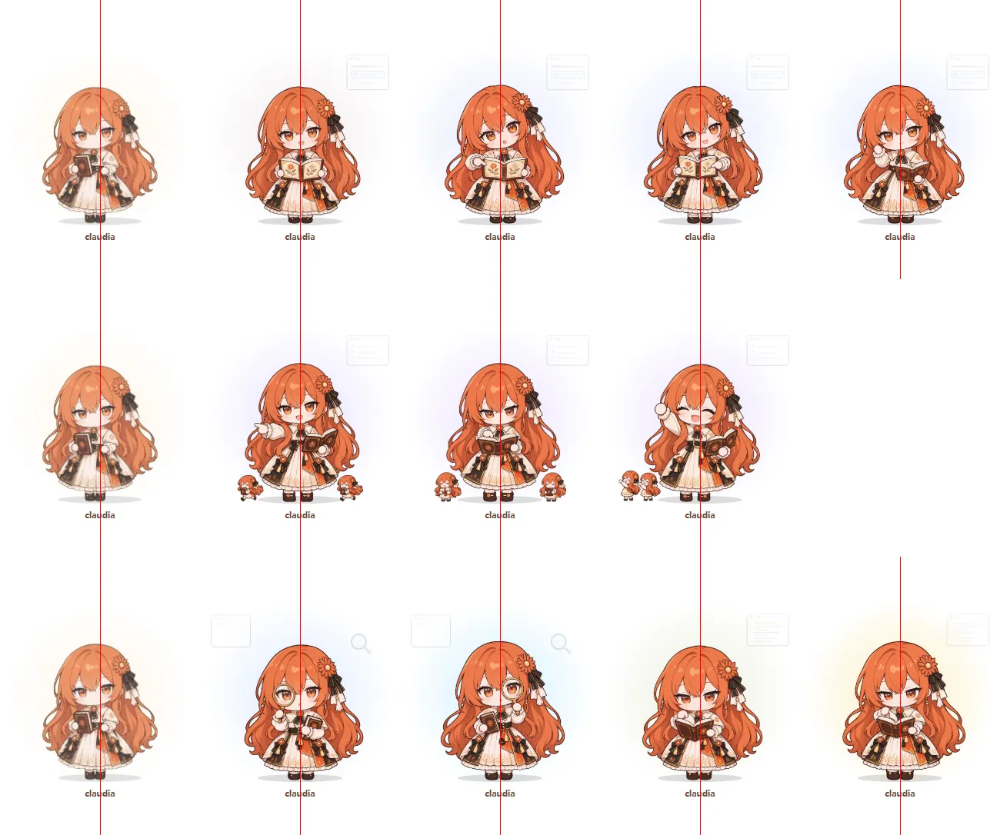

# 工作状态 · 补帧（循环翻页）

2026-11-06。会停很久的工作状态原来只有一张静态图，这次各补几帧，按 `character.json` 的 `frames` 循环翻页（`loop`，每张 0.9–2.4 秒）。用户定：累了不补；有事问你多画几张、按新比例重画；派活按 Claude 的方案；查资料、看书一起做。

| 姿态 | 帧（按播放顺序，循环） | 每张停留（毫秒） |
|---|---|---|
| asking 有事问你 | `asking` 摊开书给你看 → `asking-2` 歪头指左页 → `asking` → `asking-3` 指右页 → `asking` → `asking-4` 放低书、探身挥手 | 1800、1300、900、1300、900、1600 |
| delegating 派活 | `delegating` 指派、两个小分身出发 → `delegating-2` 对照清单 → `delegating-3` 举手给小分身打气 | 1800、1600、1300 |
| searching 查资料 | `searching` → `searching-2` 放大镜换到另一只眼 | 1700、1700 |
| reading 看书 | `reading` → `reading-2` 翻页 | 2400、900 |

- 生成：Claude 直接调用本机 Codex 命令行（gpt-6.1-terra、medium、不加速、只读），每张新开会话。附图：共用的设计参考、比例参考（`../立绘重画-统一比例/refs/共用/`）+ 第 3 张：`asking`、`delegating` 底图用旧比例原图（只看姿势），其余用本套底图。提示词在 [提示词/](提示词/)。
- `asking`、`delegating` 底图按新比例重画（原来是 CrossPet 旧比例）；`searching`、`reading` 底图沿用 2026-11-05 第二轮重画的图，只是改成和第二帧一样按头的中线对齐。
- 处理：`scripts/prepare-sprites.py` 的 `SEQUENCE`，同一套用同一个缩放（按头宽对齐），按头的中线对齐。`delegating-3` 人画小了一成，单独放大；查资料、看书的第二帧画得大一成，底图缩小约 3% 才放得下。
- 原图在本机 `D:\claudia图codex生成\<帧名>_codex_<编号>.png`；换下来的 4 张旧图备份在本机 `build/旧立绘备份-工作状态补帧前/`。
