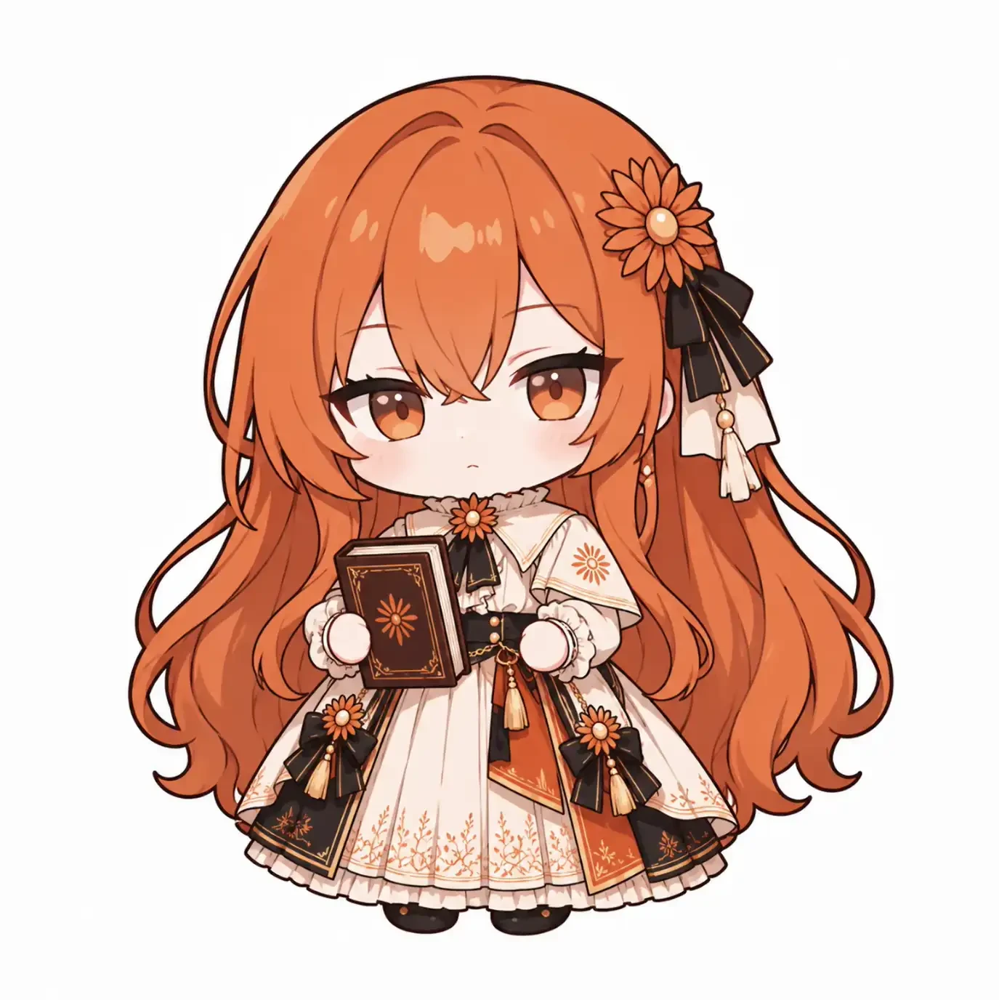

# claudia 新动作立绘 · 生图提示词（第三版：重画爬起）

只重画一张：爬起 `getup.png`。第二版画出来的爬起是跪坐着、两手抱书、眨眼害羞，有两个问题：

- 姿势像「跪着歇一会儿」，不像在起身；接在摔倒 / 趴地后面、再换回站立图时显得跳。
- 「不好意思」的表情只接得上没火气的情况；被晃出火气时，爬起来后紧接着是发火，害羞的脸接不上。

这一版（用户 2026-11-04 定）改成：**两腿都弯着、半起身，一只手拍裙子上的灰，书夹在另一只胳膊底下；表情慌慌忙忙**（眉毛上扬、小嘴微张像在说「哎呀」，带点脸红和一点点嘟嘴）。慌张两边都接得上：没火气时是「哎呀摔了，赶紧起来」，有火气时是慌忙爬起来再发火。

写法和第二版一样（沿用 CrossPet v1.3.8 的「角色生图提示词」，CC BY-NC-SA 4.0）：「通用格式规则」大部分、「角色锁定」取自 CrossPet 原文（删去和动作冲突的两句），附图说明、手的画法、姿态描述是本项目新写的。

## 这张图在程序里怎么接

摔倒（坐地）或趴地 → **爬起（这张，约 1.2 秒）** → 站回平常的样子（程序会加一个从低处往上伸展的过渡）。所以这张要正好在「坐 / 趴」和「站直」中间：比站立矮一些，但已经明显离开地面，正面朝前（不要侧身往一边跑）。

## 画之前

1. **打开透明背景**：`transparent_background: true`。
2. 附图按文件名数字顺序上传，在 `refs/getup-v2/` 里。
3. 原图（PNG）存下来交给对齐脚本 `scripts/prepare-sprites.py`。
4. 如果拍裙子的手总是画乱，可以把 POSE 里拍裙子那句换成「the free hand rests on her knee」，只保留半起身加慌张。

附图（`refs/getup-v2/`）：

| 顺序 | 文件 | 用途 |
|---|---|---|
| 1 |  `1-ref-claude.webp` | 唯一的设计参考 |
| 2 |  `2-stagger.webp` | 书夹在胳膊底下的拿法、圆手的画法、站着时的大小（不要照它的晕眼和张开的双臂） |
| 3 |  `3-oops.webp` | 慌慌张张的表情、眉毛和脸红（不要照它的姿势，也不要画眼泪） |

```
You are drawing a new desktop-pet sprite for an existing chibi character.

ATTACHED IMAGES:
- Image 1 is the ONLY design reference: copy her face, hair, hair flower, outfit, colors, proportions and art style from Image 1.
- Image 2 is an existing sprite of the same character, given ONLY to show how she holds the book tucked under one arm, how her round mitten hands are drawn, and her standing size. Do NOT copy its dizzy swirl eyes or its outstretched arms.
- Image 3 is an existing sprite of the same character, given ONLY for her flustered expression: raised worried eyebrows, a small open mouth, blush. Do NOT copy its pose (hands at her chin) and do NOT draw tears.
- If anything differs from Image 1, follow Image 1.

FORMAT RULES:
- Transparent background: real transparency (alpha). No floor, no ground shadow, no glow, no vignette, no frame. Keep the complete edges of the character (every hair strand, ribbon and tassel), nothing cropped. If a reference image has a white background, do NOT copy it.
- No text, no letters, no speech bubbles and no effects of any kind floating in the air: no stars, no dust clouds, no motion lines, no emphasis lines, no ?, !, hearts, music notes, Zzz, sparkles, sweat-drop icons. The app draws all effects itself.
- Exactly one character, full body, centered, facing the viewer (not turned sideways, not running off to one side).
- SCALE LOCK: draw her at exactly the same size as in Image 1 and Image 2: the same head size and the same body proportions. Do NOT enlarge her to fill the image. Half-risen with bent knees, she is shorter than when standing: leave the empty space ABOVE her transparent.
- GROUND LINE: the bottom of the image is the floor; both boots touch the bottom edge.
- HANDS: small, round, mitten-like hands with NO separate fingers and no finger or palm lines, exactly the way hands are drawn in Image 1 and Image 2.
- The whole pose stays inside the square canvas with a margin on the left and right.
- A continuous, closed dark outline around the whole silhouette.
- Same art style as Image 1: clean lineart, flat two-tone cel shading, soft palette, chibi about 2.5 heads tall, big head, round soft shapes.
- Square image, 1024x1024 or larger. Save as getup.png.

CHARACTER LOCK — Claude, the anime-girl personification of Claude (Anthropic).
Personality: gentle, calm, bookish, a little shy, quietly cheerful; she thinks before she speaks.
Keep exactly:
- Long wavy copper-orange hair, loose side-swept bangs, warm amber eyes.
- An orange daisy-like hair flower with a black striped ribbon bow and a white tassel on HER LEFT side (viewer's right); small drop earrings.
- Cream-white dress with a short cape collar, orange flower embroidery, orange and black front panels, small black bows with gold tassels, a black waist sash, an orange flower brooch at the collar; dark brown boots.
- Signature prop: a dark brown hardcover book with an orange flower emblem.

STYLE NOTE: soft, modest and a little comical. The dress always covers her properly.

POSE — getup.png: she is hurriedly getting back up after a fall, halfway up. Facing the viewer, both boots on the floor, BOTH knees bent in a half-crouch, her upper body leaning a little forward, rising. One arm keeps the book tucked under it against her side; the other hand pats the dust off the front of her skirt. Expression: flustered and in a hurry, neither happy nor angry: eyebrows raised, eyes wide open, a small open mouth as if saying "oops", light blush, the lips pushed out just a little. One strand of hair is a little out of place. No tears. She is clearly off the floor, but not yet standing straight.
```

## 自查清单

- [ ] 背景真透明：没有白底、没有地面投影、没有外框。
- [ ] 画面里没有任何飘着的符号（星星、尘土、汗滴图标、文字都不能有）。
- [ ] 手是圆圆的连指手套状，没有手指。
- [ ] **两腿都弯着、半起身**，不是跪着、坐着，也没有站直；正面朝前，不是侧身往一边跑。
- [ ] 书夹在一只胳膊底下，另一只手在拍裙子（或按备选放在膝盖上）。
- [ ] 表情是慌慌忙忙：不笑、不害羞，也不生气、不哭。
- [ ] 人物和参考图一样大；比站立矮一些，上方留出透明空白。
- [ ] 靴子贴着图片底边；发饰在她的左侧（画面右侧），衣服和参考图一致。

## 生成记录（画完后填）

| 文件 | 日期 | 生成工具 | 附图 | 提示词有没有改 |
|---|---|---|---|---|
| `getup.png` | 2026-11-04 | OpenAI Codex 内置 image_gen | `refs/getup-v2/` 三张 | 未确认（用户生成了两张；选用 `01e1ee1d…_720.png`：两腿弯着前倾、一手伸向裙子、慌张表情。另一张 `6929e944…_720.png` 是眨眼笑、两腿大开蹲着，表情偏开心，没用） |
