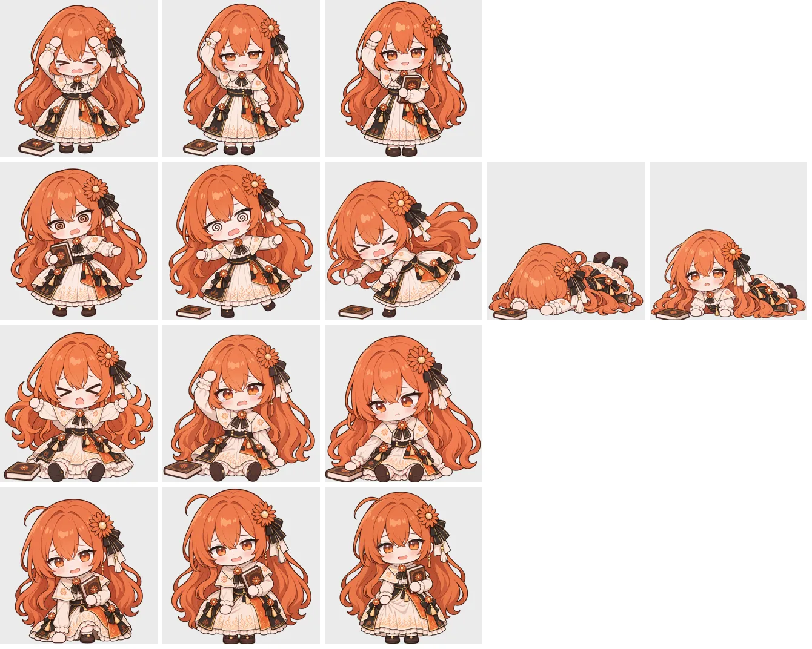

# 碰边一套 · 按新比例重画 + 补帧

2026-11-06。被扔出去碰边时的五个姿态（撞头、站不稳、趴地、摔倒、爬起）原来每个只有一张旧比例的静态图，夹在动画之间显得僵。这次按动画比例重画，并给每段补了过渡帧，一共 14 张，连着翻页播放。用户把这一套全权交给 Claude 设计，最后确认定稿。

## 帧表

| 姿态 | 帧（按播放顺序） | 每张停留（毫秒） |
|---|---|---|
| bonk 撞头 | `bonk` 撞上 → `bonk-2` 揉头 → `bonk-3` 捡回书、拍拍头 | 550、700、停住 |
| stagger 站不稳 | `stagger` 晃向一边 → `stagger-2` 晃向另一边、书掉了 → `stagger-3` 往前栽 | 450、450、停住 |
| faceplant 趴地 | `faceplant` 脸朝下 → `faceplant-2` 抬头撑起上身 | 800、停住 |
| fallen 摔倒 | `fallen-1` 着地一瞬 → `fallen` 坐着揉头 → `fallen-2` 伸手够书 | 300、900、停住 |

碰边计时（`web/tumble.js` 的 `STEPS`）到了就换回站姿：撞头最后一张已经站好；摔倒、趴地演完直接站回去（从低处往上伸展一下），没火气说一句「嘿咻…」，有火气直接接生气动作。

**爬起不用了（2026-11-06）**：原来还画了爬起三张（`getup` 单膝跪地 → `getup-2` 半蹲 → `getup-3` 站直拍裙子，提示词 `008`、`016`、`014`），摔倒和趴地都接它。用户实测说趴地、摔倒和爬起完全不连贯：两种倒法结束时身体朝向、书的位置都不一样，接不上同一套爬起。用户决定去掉爬起，倒地后直接接情绪。三张图在提交 `40434de` 里还能找到。

## 怎么生成的

- Claude 直接调用本机 Codex 命令行（`codex exec`，模型 gpt-6.1-terra、推理 medium、不加速、只读沙箱）生图，用户只确认结果。
- 每张附 3 张图：`../立绘重画-统一比例/refs/共用/` 的设计参考和比例参考，加第 3 张——第一批用旧比例的现有立绘（只看姿势），第二批用本套上一帧的新图（保证接得上）。
- 每张的完整提示词在 [提示词/](提示词/)（编号是生成顺序；`012`、`013` 是 fallen-2、getup-2 的第一版，没采用，重画为 `015`、`016`；fallen-2 的 `015` 版用户实测说头奇怪、发糊（头顶头发堆太高、眉头像生气、线条偏软），又重画为 `017`）。
- 原图在本机 `D:\claudia图codex生成\<帧名>_codex_<编号>.png`；对话记录、脚本在本机 `build/codex-imagegen/`（不进 git）。

## 处理

`scripts/prepare-sprites.py` 的 `SEQUENCE` 表：每张按固定倍数缩放（凭眼按头的大小和待机图对齐，生图时坐着、跪着的头画得偏大），水平按头的中线对齐（趴地两张按整体中心），画布左右对称包住对齐线，这样书掉在哪边人都不跳。换下来的 6 张旧图备份在本机 `build/旧立绘备份-碰边补帧前/`（有哈希和还原说明）。

## 素材来源

- 设计参考：CrossPet v1.3.8 的 Claude 娘设计图（CC BY-NC-SA 4.0）。
- 比例参考：hunmer 的 claude-pet 动作包「待机呼吸休闲」第 0 帧（hunmer/aboutme-pets，书面授权 CC BY-NC-SA 4.0）。
- 生成工具：OpenAI Codex 的图片生成。
