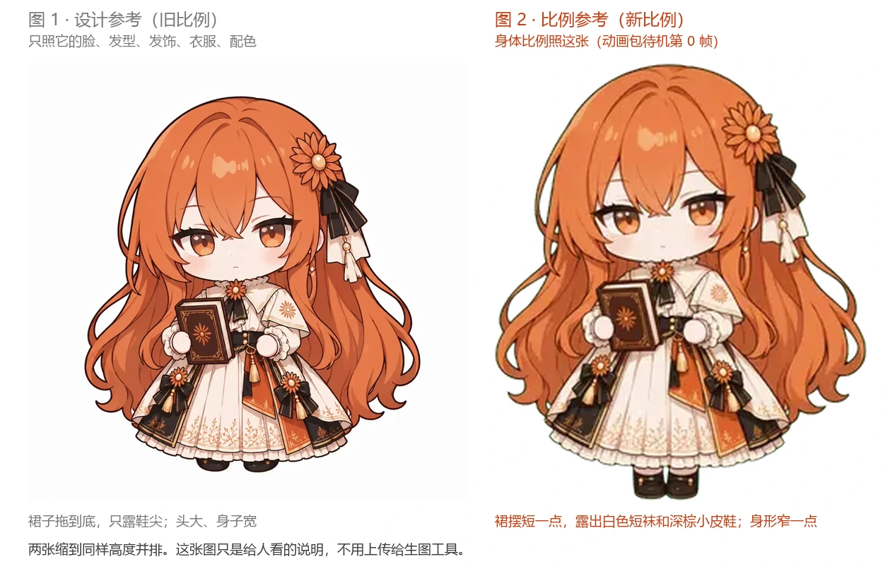

# claudia 立绘重画 · 统一比例 · 生图提示词

整理：2026-11-05。要重画 20 张静态立绘，让它们和动画动作（hunmer 的 claude-pet 动作包）的身体比例一致。哪 20 张、为什么是这 20 张，见 [../../立绘比例统一清单.md](../../立绘比例统一清单.md) 第一节。

**要改的只有比例**：姿势、表情、道具都照现在这张旧图，脸、发型、衣服、配色照设计参考。比例的区别见同一文件夹里的 [比例说明图-不用上传.webp](比例说明图-不用上传.webp)：



- 旧比例（现在的立绘、CrossPet 设计参考）：裙子拖到底，只露鞋尖；头大、身子宽。
- 新比例（动画）：头一样大，裙摆短一点，**裙子下面露出一小截穿白袜的腿，大约是鞋子高度的一半，再下面是深棕色小皮鞋**；宽度和动画一样。
- **2026-11-05 第一轮的教训**：最早的提示词写成「露出白色短袜和一小截小腿」「身形窄一点」，画出来裙摆以下占了全身 19–23%（动画约 13%），最宽处 ÷ 身高只有 0.67–0.76（动画 0.85），人显得瘦高。已改成下面的写法，重画时以这一版为准。

写法沿用前几版（CrossPet v1.3.8 的「角色生图提示词」，CC BY-NC-SA 4.0）：「通用格式规则」大部分、「角色锁定」取自 CrossPet 原文，比例锁定、附图说明和每张的姿势是本项目新写的。

## 怎么用

1. **打开透明背景**：`transparent_background: true`。
2. **每张上传 3 张附图，按编号顺序**：
   - 第 1 张、第 2 张每次都一样，在 [refs/共用/](refs/共用/)；
   - 第 3 张是这个姿态现在的旧图，在 `refs/<姿态名>/`。
3. **提示词 = 下面的「通用部分」+ 这一张的「这张的部分」**，两段接在一起贴进去。
4. 原图（PNG）存成表里的文件名（生成工具自动起的名字也行，记在最后的「生成记录」里），先放到 `build/new-sprites/`（不进 git）。之后用对齐脚本 `scripts/prepare-sprites.py` 去背景杂点、统一大小（站立的按待机图一样高）、底边对齐，再转成 WebP 放进 `characters/claude/`。**这个脚本里的文件对照表是写死的，目前只有碰边那几张**，图画好后告诉我，我把这 20 张加进去再跑。
5. 画完在最后的「生成记录」里记一笔。

### 附图（文件名就是标注）

| 顺序 | 文件 | 管什么 | 不要照它的什么 |
|---|---|---|---|
| 1 |  [`refs/共用/1-设计参考-脸发型衣服配色.webp`](refs/共用/1-设计参考-脸发型衣服配色.webp) | 脸、发型、发饰、衣服、配色、画风（CrossPet 的 Claude 娘设计图） | 比例（它是旧比例）；白底 |
| 2 |  [`refs/共用/2-比例参考-身体比例照这张.webp`](refs/共用/2-比例参考-身体比例照这张.webp) | **身体比例**：头和身子的比例、裙摆高度（下面露一小截白袜，约鞋子一半高，再接鞋）、身形宽窄（动画包「待机呼吸休闲」第 0 帧，作者 hunmer） | 它比较糊、颜色偏淡，画风还是照第 1 张 |
| 3 | `refs/<姿态名>/3-旧图-只看姿势表情道具-<姿态名>.webp` | 这张的姿势、表情、手里的道具、帽子等装扮 | 比例（旧比例：裙子太长、身子太宽） |

## 通用部分（每张都贴）

```
You are redrawing an existing desktop-pet sprite of a chibi character so that her body proportions match her new animations.

ATTACHED IMAGES:
- Image 1 is the DESIGN reference: copy her face, hair, hair flower, outfit, colors and clean art style from Image 1. Do NOT copy its body proportions.
- Image 2 is the PROPORTION reference: copy her body proportions from Image 2 exactly. Image 2 is a slightly blurry animation frame; use it only for proportions, not for line quality or colors.
- Image 3 is the OLD sprite of the pose you are drawing: copy its pose, expression, props and accessories, but NOT its body proportions (its skirt is too long and its body too wide).
- If face, hair or outfit details differ between the images, follow Image 1. If body proportions differ, follow Image 2.

PROPORTION LOCK (follow Image 2):
- About 2.5 heads tall, a chubby chibi: big head, short body. Her head is the same size as in Image 2.
- The skirt is long: its hem ends a little above her shoes. Below the hem only a SHORT bit of her legs shows, in white socks: that bit is about half as tall as the shoes, then the small dark brown Mary-Jane shoes, exactly like in Image 2. Do NOT show long legs: no knees, no long white stockings, no long shins.
- The part below the skirt hem (socks and shoes together) is only about one eighth of her full height. The skirt and the long wavy hair are as wide as in Image 2; do NOT make her slim, thin or tall.
- Draw her at the same size as in Image 2. Do NOT enlarge her to fill the image.

FORMAT RULES:
- Transparent background: real transparency (alpha). No floor, no ground shadow, no glow, no vignette, no frame. Keep the complete edges of the character (every hair strand, ribbon and tassel), nothing cropped. If a reference image has a white background, do NOT copy it.
- No text, no letters, no speech bubbles and no effects of any kind floating in the air: no stars, no motion lines, no emphasis lines, no ?, !, hearts, music notes, Zzz, sparkles, sweat-drop icons, anger marks. The app draws all effects itself.
- Exactly one character, full body, centered, facing the viewer unless the pose says otherwise.
- GROUND LINE: the bottom of the image is the floor; both shoes touch the bottom edge.
- HANDS: small, round, mitten-like hands with NO separate fingers and no finger or palm lines, the way hands are drawn in Image 1.
- Props (the ones named in the pose) are held close to her body and stay inside the canvas with a margin on the left and right.
- A continuous, closed dark outline around the whole silhouette.
- Same art style as Image 1: clean lineart, flat two-tone cel shading, soft palette, round soft shapes.
- Square image, 1024x1024 or larger. Save with the file name given below.

CHARACTER LOCK — Claude, the anime-girl personification of Claude (Anthropic).
Personality: gentle, calm, bookish, a little shy, quietly cheerful; she thinks before she speaks.
Keep exactly:
- Long wavy copper-orange hair, loose side-swept bangs, warm amber eyes.
- An orange daisy-like hair flower with a black striped ribbon bow and a white tassel on HER LEFT side (viewer's right); small drop earrings.
- Cream-white dress with a short cape collar, orange flower embroidery, orange and black front panels, small black bows with gold tassels, a black waist sash, an orange flower brooch at the collar; short white frilled socks and dark brown Mary-Jane shoes.
- Signature prop: a dark brown hardcover book with an orange flower emblem.

STYLE NOTE: soft, modest and a little comical. The dress always covers her properly.
```

## 这张的部分（20 张）

每张：先贴「通用部分」，再贴下面对应的一段。

### 工作状态

#### 1. listening 听你说 → `listening.png`

Claude 收到你的消息时，先「听」一下再开始想。台词：「听到啦！」「嗯嗯，你说」。附图第 3 张：[refs/listening/](refs/listening/)

```
POSE — listening.png: she has just heard you and is listening attentively. Facing the viewer, standing straight. One arm holds the closed book against her chest; the other hand is raised a little near her cheek as if saying "mm, go on". Expression: attentive and a little surprised, eyes open wide, a small round open mouth, slight blush.
```

#### 2. reading 看书 → `reading.png`

Claude 在读文件时。台词：「翻书中…」「我看看这里写了什么」。附图第 3 张：[refs/reading/](refs/reading/)

```
POSE — reading.png: she is reading. Facing the viewer, standing straight, holding the book OPEN with both hands in front of her chest, pages facing her; one hand points at a line on the page. Her head tilts down a little and her eyes look down at the page. Expression: calm and focused, mouth closed.
```

#### 3. busy_left 忙碌（左） → `busy_left.png`

好几个 Claude 会话同时在忙时，会话卡片排在她画面左右两边，她轮流看两边：这张看向画面左边，和下一张每 1.5 秒左右交替（左右都以画面为准）。台词：「两边都在看，稍等我一下～」。附图第 3 张：[refs/busy_left/](refs/busy_left/)

```
POSE — busy_left.png: she is juggling two tasks at once. Standing, body facing the viewer, holding TWO open books, one raised in each hand, arms spread a little. Her head and eyes turn toward the VIEWER'S LEFT, looking at the book on that side. Expression: busy and a little flustered, eyebrows slightly worried, mouth small. Draw no sweat-drop icon.
```

#### 4. busy_right 忙碌（右） → `busy_right.png`

同上，看向画面右边。**不要拿上一张镜像翻转**：发饰固定在她的左侧（画面右侧），翻转会跑到另一边。附图第 3 张：[refs/busy_right/](refs/busy_right/)

```
POSE — busy_right.png: the same moment as busy_left, now looking the other way. Standing, body facing the viewer, holding TWO open books, one raised in each hand, arms spread a little. Her head and eyes turn toward the VIEWER'S RIGHT, looking at the book on that side. Expression: busy and a little flustered, eyebrows slightly worried, mouth small. Keep the hair flower on HER LEFT side (viewer's right); do not mirror the character. Draw no sweat-drop icon.
```

#### 5. searching 查资料 → `searching.png`

Claude 上网搜索时。台词：「上网查查」「找资料中…」。附图第 3 张：[refs/searching/](refs/searching/)

```
POSE — searching.png: she is looking something up. Facing the viewer, standing straight. One hand holds a round brass magnifying glass up in front of one eye; the other arm holds the closed book against her side. Expression: curious and searching, eyes wide, mouth a small "o".
```

#### 6. oops 哎呀 → `oops.png`

出错时。台词：「诶？出错了…」「呜，没成功」。附图第 3 张：[refs/oops/](refs/oops/)

```
POSE — oops.png: something went wrong. Facing the viewer, standing, both round hands raised together near her chin, the book tucked under one arm. Expression: worried and a little upset, eyebrows tilted up, mouth slightly open and wavy, light blush. Watery eyes are fine, but no falling tears.
```

#### 7. tired 累了 → `tired.png`

额度快用完时的常态（会停很久）。台词：「额度快见底了…」「有点累了…」。附图第 3 张：[refs/tired/](refs/tired/)

```
POSE — tired.png: she is worn out. Facing the viewer, standing with her shoulders drooping and her head tilted a little down. Both hands hold the closed book low in front of her skirt, arms hanging. Expression: sleepy and tired, half-closed heavy eyelids, mouth a small flat line. A few strands of hair a little messy.
```

### 生气与和好

#### 8. puffed 鼓脸 → `puffed.png`

被甩得生气的第二档（第一档「不耐烦」已经是动画）。台词：「再晃书就要掉了！」「哼，晃了这么久……」。附图第 3 张：[refs/puffed/](refs/puffed/)

```
POSE — puffed.png: she is annoyed and pouting. Facing the viewer, standing, hugging the closed book tightly to her chest with both arms. Her cheeks are puffed out, lips pushed into a pout, eyes narrowed and glancing sideways, a clear blush. Cute-angry, not scary. Draw no anger-mark icon.
```

#### 9. sulk 赌气 → `sulk.png`

红温之后背过身去赌气，要哄才好。台词：「……」「我在看书，没空理你。」附图第 3 张：[refs/sulk/](refs/sulk/)

```
POSE — sulk.png: she is sulking with her back half turned. Her body turns away from the viewer about three-quarters (we see her back and one shoulder, her long hair covering much of her back), and she looks back over her shoulder at the viewer. She hugs the closed book in front of her. Expression: sulky, a small pout, eyes half-lidded and looking sideways, light blush. Both shoes still on the floor.
```

#### 10. dizzy 晕乎乎 → `dizzy.png`

被甩晕了，站不太稳。台词：「别、别晃了……书要掉了……」「头好晕……」。附图第 3 张：[refs/dizzy/](refs/dizzy/)

```
POSE — dizzy.png: she is dizzy after being shaken. Facing the viewer, standing but swaying: her head and upper body tilt to one side, her knees a little bent. The book is held loosely in one hand, about to slip. Expression: dazed, eyes unfocused and a little crossed (normal eyes, NOT spiral eyes), mouth slightly open, light blush. A few hair strands out of place. Draw no stars or swirl effects.
```

#### 11. coaxed 被哄 → `coaxed.png`

生气时被你摸头，嘴上不服、心里在消气。台词：「……摸头也没用。」「……再摸一下。」附图第 3 张：[refs/coaxed/](refs/coaxed/)

```
POSE — coaxed.png: she is being patted on the head while still a bit cross. Facing the viewer, standing, hugging the closed book to her chest with both arms. Her head tilts very slightly as if leaning into a pat. Expression: pretending to still be cross but softening: eyes looking aside, a tiny pout, a clear blush. No hand of another person is drawn.
```

#### 12. forgiven 原谅你 → `forgiven.png`

哄好了。台词：「……这次就原谅你。」「下次不许这样了哦。」附图第 3 张：[refs/forgiven/](refs/forgiven/)

```
POSE — forgiven.png: she has forgiven you. Facing the viewer, standing, holding the closed book up in front of her face with both hands so it covers her mouth and chin, peeking over the top of it. Expression: shy and relieved, eyes soft and looking at the viewer, a clear blush; we can tell she is smiling behind the book.
```

### 时段问候

打开时按时段打招呼，停 5.5 秒。

#### 13. greet_dawn 凌晨 → `greet_dawn.png`

台词：「天快亮了呢……我还醒着」「嗯……我就在这儿」。附图第 3 张：[refs/greet_dawn/](refs/greet_dawn/)

```
POSE — greet_dawn.png: very early morning, she has stayed up. Facing the viewer, standing. She wears a soft orange nightcap with a white pompom (the hair flower still visible) and a cream blanket wrapped around her shoulders over the dress. Both hands hold the closed book in front of her. Expression: sleepy but gentle, half-closed eyes, a small soft smile.
```

#### 14. greet_morning 早上好 → `greet_morning.png`

台词：「早上好。我泡了茶」「早呀，今天也一起吧」。附图第 3 张：[refs/greet_morning/](refs/greet_morning/)

```
POSE — greet_morning.png: good morning, she has made tea. Facing the viewer, standing. One hand holds a small white teacup on a saucer in front of her chest (a little steam is NOT drawn); the other arm holds the closed book. Expression: fresh and warm, eyes open, a gentle smile.
```

#### 15. greet_noon 中午好 → `greet_noon.png`

台词：「中午啦，我也去吃点东西」「午饭吃什么呢……想吃便当」。附图第 3 张：[refs/greet_noon/](refs/greet_noon/)

```
POSE — greet_noon.png: lunchtime. Facing the viewer, standing. She holds an open bento box in front of her with one hand and a pair of chopsticks in the other, about to eat; the book is tucked under one arm. Expression: happy and a little hungry, eyes bright, a small smile.
```

#### 16. greet_afternoon 下午好 → `greet_afternoon.png`

台词：「下午茶时间～」「下午的阳光好舒服」。附图第 3 张：[refs/greet_afternoon/](refs/greet_afternoon/)

```
POSE — greet_afternoon.png: afternoon tea. Facing the viewer, standing. One hand holds a small plate with a slice of cake, the other a small teacup. Expression: content and relaxed, eyes closed in a happy curve, a soft smile, light blush.
```

#### 17. greet_evening 晚上好 → `greet_evening.png`

台词：「晚上好，今天辛苦啦」「晚上好，我点上灯了」。附图第 3 张：[refs/greet_evening/](refs/greet_evening/)

```
POSE — greet_evening.png: evening, she has lit a lamp. Facing the viewer, standing. One hand holds a small brass oil lantern by its handle (the flame is drawn inside the lantern, no glow around it); the other hand holds the book open against her chest. Expression: warm and calm, a gentle smile.
```

#### 18. greet_night 晚安 → `greet_night.png`

台词：「夜里好安静呀」「这么晚了，我陪着你」。附图第 3 张：[refs/greet_night/](refs/greet_night/)

```
POSE — greet_night.png: late at night, quiet. Facing the viewer, standing. She holds the book open in one hand and a small candle in a brass holder in the other (the flame is drawn, no glow around it). Expression: quiet and soft, eyes calm, a small smile.
```

### 节日

#### 19. fest_newyear 元旦 → `fest_newyear.png`

台词：「新年快乐！今年也请多关照」「新的一年，一起写下新的一页吧」。附图第 3 张：[refs/fest_newyear/](refs/fest_newyear/)

```
POSE — fest_newyear.png: New Year's Day. Facing the viewer, standing. She wears a small cone party hat with a white pompom, and a short festive orange-red capelet with white fur trim over her dress. One hand holds up a party popper with a few curly paper streamers coming out of it (the streamers are part of the prop and stay close to it); the other arm holds the book. Expression: joyful, eyes closed in a happy curve, mouth open in a big smile.
```

#### 20. fest_national 国庆 → `fest_national.png`

台词：「假期快乐！我也出门走走」「国庆快乐～去哪儿玩呀？」附图第 3 张：[refs/fest_national/](refs/fest_national/)

```
POSE — fest_national.png: holiday trip. Facing the viewer, standing. She wears a wide-brimmed cream sun hat with a black ribbon (the hair flower is pinned on the hat band on her left side) and a light orange scarf. One hand holds the book; the other hand holds the handle of a small cream rolling suitcase with an orange flower emblem standing beside her on the floor. Expression: cheerful and ready to go, a gentle smile. The hat brim and the suitcase stay inside the canvas.
```

## 自查清单（每张都过一遍）

- [ ] **比例对上第 2 张**：裙子下面露出的白袜那一截只有鞋子高度的一半左右，**不是一长截腿**；人不瘦高，宽度和第 2 张差不多。
- [ ] 脸、发型、发饰、衣服和第 1 张一致；发饰在她的左侧（画面右侧）。
- [ ] 姿势、表情、道具和第 3 张一致（busy_right、sulk 这类本来就转向的，按这一段的描述）。
- [ ] 背景真透明：没有白底、没有地面投影、没有外框。
- [ ] 画面里没有飘着的符号（星星、音符、汗滴、怒气标、文字都不能有）；灯和蜡烛只画火苗，不画光晕。
- [ ] 手是圆圆的连指手套状，没有手指。
- [ ] 人物没有被放大塞满画面；鞋子贴着图片底边；道具和帽檐没出画面。
- [ ] 文件名和表里一致（reading 存成 `reading.png`，不是 `reading-2`）。

## 可以多画一张的（可选）

清单第五节里，这几个会停比较久、或者夹在动画中间，单张容易显得“定住了”。想要的话，在同一段提示词后面加一句变化，存成带 `-2` 的文件名：

| 文件 | 在提示词最后加 |
|---|---|
| `listening-2.png` | `Variation: she nods, eyes closed for a moment, mouth closed in a small smile.` |
| `reading-2.png` | `Variation: she is turning a page with one hand, eyes following the page.` |
| `tired-2.png` | `Variation: she is in the middle of a small yawn, one hand covering her mouth, eyes closed.` |
| `puffed-2.png` | `Variation: she turns her face away to the viewer's left with a "hmph", eyes closed, cheeks still puffed.` |
| `sulk-2.png` | `Variation: she peeks back at the viewer a little more, one eye open, still pouting.` |

说明：程序现在对同一个姿态的多张图是隔 8 秒左右换一张，不是连贯播放；想做成短循环小动画，要另外改程序。

## 生成记录

2026-11-05 画了两轮。第一轮（20:25 那批）按最早的比例段画，腿露太多、人偏瘦高；改正比例段后第二轮（21:25 那批）裙摆以下约占全身 12–14%、宽高比 0.80–0.92，和动画（约 13%、0.85）对得上，换进了 `characters/claude/`；第一轮备份在本机 `build/第一轮重画-偏瘦高/`。用 `scripts/prepare-sprites.py --only …` 处理（表 `STANDING`：每张单独缩放到和待机图一样高，扣掉帽子），换下来的旧图备份在本机 `build/旧立绘备份-比例统一前/`（不进 git）。原图文件名是生成工具自动起的编号，按画面逐张认出姿态；忙碌左右按书举在哪一边区分。

| 文件 | 日期 | 生成工具 | 附图 | 提示词有没有改 | 选用哪张 / 备注 |
|---|---|---|---|---|---|
| `listening.png` | 2026-11-05 | OpenAI Codex（原图放在 `D:\claudia图codex生成`） | 共用 1、2 + refs/listening | 第二轮按改正后的比例段 | 用第二轮原图 `f2905175…_720.png`（第一轮 `9b306a24…` 腿太长没用）（同名 `_0.png` 是压缩图） |
| `reading.png` | 2026-11-05 | OpenAI Codex（原图放在 `D:\claudia图codex生成`） | 共用 1、2 + refs/reading | 第二轮按改正后的比例段 | 用第二轮原图 `fdca2cd3…_720.png`（第一轮 `c42baa80…` 腿太长没用）（同名 `_0.png` 是压缩图） |
| `busy_left.png` | 2026-11-05 | OpenAI Codex（原图放在 `D:\claudia图codex生成`） | 共用 1、2 + refs/busy_left | 第二轮按改正后的比例段 | 用第二轮原图 `502c419b…_720.png`（第一轮 `b520e957…` 腿太长没用）（同名 `_0.png` 是压缩图） |
| `busy_right.png` | 2026-11-05 | OpenAI Codex（原图放在 `D:\claudia图codex生成`） | 共用 1、2 + refs/busy_right | 第二轮按改正后的比例段 | 用第二轮原图 `be3f062a…_720.png`（第一轮 `3a990f0c…` 腿太长没用）（同名 `_0.png` 是压缩图） |
| `searching.png` | 2026-11-05 | OpenAI Codex（原图放在 `D:\claudia图codex生成`） | 共用 1、2 + refs/searching | 第二轮按改正后的比例段 | 用第二轮原图 `28ef8401…_720.png`（第一轮 `6f2f64c5…` 腿太长没用）（同名 `_0.png` 是压缩图） |
| `oops.png` | 2026-11-05 | OpenAI Codex（原图放在 `D:\claudia图codex生成`） | 共用 1、2 + refs/oops | 第二轮按改正后的比例段 | 用第二轮原图 `923f6301…_720.png`（第一轮 `ea16f36d…` 腿太长没用）（同名 `_0.png` 是压缩图） |
| `tired.png` | 2026-11-05 | OpenAI Codex（原图放在 `D:\claudia图codex生成`） | 共用 1、2 + refs/tired | 第二轮按改正后的比例段 | 用第二轮原图 `c38cbab2…_720.png`（第一轮 `7e67c70a…` 腿太长没用）（同名 `_0.png` 是压缩图） |
| `puffed.png` | 2026-11-05 | OpenAI Codex（原图放在 `D:\claudia图codex生成`） | 共用 1、2 + refs/puffed | 第二轮按改正后的比例段 | 用第二轮原图 `652d9dbc…_720.png`（第一轮 `7430a551…` 腿太长没用）（同名 `_0.png` 是压缩图） |
| `sulk.png` | 2026-11-05 | OpenAI Codex（原图放在 `D:\claudia图codex生成`） | 共用 1、2 + refs/sulk | 第二轮按改正后的比例段 | 用第二轮原图 `6a54bf08…_720.png`（第一轮 `09bf46fd…` 腿太长没用）（同名 `_0.png` 是压缩图） |
| `dizzy.png` | 2026-11-05 | OpenAI Codex（原图放在 `D:\claudia图codex生成`） | 共用 1、2 + refs/dizzy | 第二轮按改正后的比例段 | 用第二轮原图 `4f15013d…_720.png`（第一轮 `f0b0737e…` 腿太长没用）（同名 `_0.png` 是压缩图） |
| `coaxed.png` | 2026-11-05 | OpenAI Codex（原图放在 `D:\claudia图codex生成`） | 共用 1、2 + refs/coaxed | 第二轮按改正后的比例段 | 用第二轮原图 `4f44f980…_720.png`（第一轮 `d3b66a50…` 腿太长没用）（同名 `_0.png` 是压缩图） |
| `forgiven.png` | 2026-11-05 | OpenAI Codex（原图放在 `D:\claudia图codex生成`） | 共用 1、2 + refs/forgiven | 第二轮按改正后的比例段 | 用第二轮原图 `aefe895d…_720.png`（第一轮 `7e3eec6e…` 腿太长没用）（同名 `_0.png` 是压缩图） |
| `greet_dawn.png` | 2026-11-05 | OpenAI Codex（原图放在 `D:\claudia图codex生成`） | 共用 1、2 + refs/greet_dawn | 第二轮按改正后的比例段 | 用第二轮原图 `96a5a8f8…_720.png`（第一轮 `cad04e38…` 腿太长没用）（同名 `_0.png` 是压缩图）；睡帽占了一点高度，人物约小 5% |
| `greet_morning.png` | 2026-11-05 | OpenAI Codex（原图放在 `D:\claudia图codex生成`） | 共用 1、2 + refs/greet_morning | 第二轮按改正后的比例段 | 用第二轮原图 `cf7a0e5d…_720.png`（第一轮 `c83268a4…` 腿太长没用）（同名 `_0.png` 是压缩图） |
| `greet_noon.png` | 2026-11-05 | OpenAI Codex（原图放在 `D:\claudia图codex生成`） | 共用 1、2 + refs/greet_noon | 第二轮按改正后的比例段 | 用第二轮原图 `b84ffd37…_720.png`（第一轮 `da6075de…` 腿太长没用）（同名 `_0.png` 是压缩图） |
| `greet_afternoon.png` | 2026-11-05 | OpenAI Codex（原图放在 `D:\claudia图codex生成`） | 共用 1、2 + refs/greet_afternoon | 第二轮按改正后的比例段 | 用第二轮原图 `761b2dca…_720.png`（第一轮 `756ec82a…` 腿太长没用）（同名 `_0.png` 是压缩图） |
| `greet_evening.png` | 2026-11-05 | OpenAI Codex（原图放在 `D:\claudia图codex生成`） | 共用 1、2 + refs/greet_evening | 第二轮按改正后的比例段 | 用第二轮原图 `a55e9590…_720.png`（第一轮 `c2b53d69…` 腿太长没用）（同名 `_0.png` 是压缩图） |
| `greet_night.png` | 2026-11-05 | OpenAI Codex（原图放在 `D:\claudia图codex生成`） | 共用 1、2 + refs/greet_night | 第二轮按改正后的比例段 | 用第二轮原图 `48596cda…_720.png`（第一轮 `489670d4…` 腿太长没用）（同名 `_0.png` 是压缩图） |
| `fest_newyear.png` | 2026-11-05 | OpenAI Codex（原图放在 `D:\claudia图codex生成`） | 共用 1、2 + refs/fest_newyear | 第二轮按改正后的比例段 | 用第二轮原图 `66ecac6a…_720.png`（第一轮 `cc8fcf1a…` 腿太长没用）（同名 `_0.png` 是压缩图）；派对帽占了画布高度，人物比别的小约一成 |
| `fest_national.png` | 2026-11-05 | OpenAI Codex（原图放在 `D:\claudia图codex生成`） | 共用 1、2 + refs/fest_national | 第二轮按改正后的比例段 | 用第二轮原图 `f7ce2230…_720.png`（第一轮 `b672147c…` 腿太长没用）（同名 `_0.png` 是压缩图） |

**补画（2026-11-06）**：`proud.png` 得意也按新比例重画了，由 Claude 直接调用 Codex 命令行生成（附图同上：共用 1、2 + 旧的 `proud.webp`），提示词见 [得意-2026-11-06-提示词.md](得意-2026-11-06-提示词.md)，原图 `D:\claudia图codex生成\proud_codex_8c33ee85.png`；花冠高出头顶约 125 px，人物比别的小一成左右（同元旦）。旧图备份在本机 `build/旧立绘备份-得意重画前/`。用户确认抱礼物（update）、抱 Clawd（clawd）、道歉（sorry）比例差得不多，不重画。

同日 `annoyed.png` 不耐烦也重画了：用户决定不耐烦换回静态图（和鼓脸、红温、赌气连成一串），原来的「点击回应-傲娇生气」动画改成点击反应。第一版以旧图为参考，腿比同一串的鼓脸长（裙摆以下约 12.5%，鼓脸 7.5%），第二版把第 3 张附图换成新比例的鼓脸、只改表情，比例对上了（宽高比 0.88、裙摆以下 9.1%）。提示词见 [不耐烦-2026-11-06-提示词.md](不耐烦-2026-11-06-提示词.md)，原图 `annoyed_codex_efd020f2.png`。

## 素材来源

- 第 1 张：CrossPet v1.3.8 的 Claude 娘设计参考图 `ref-claude.webp`（CC BY-NC-SA 4.0），和前几版提示词用的是同一张。
- 第 2 张：hunmer 的 claude-pet 动作包（[hunmer/aboutme-pets](https://github.com/hunmer/aboutme-pets) `pets/claude`，提交 `3ba083b`）「待机呼吸休闲」精灵图的第 0 帧，按人物范围裁出、放大 3 倍、转成 WebP，画面内容没有改；作者在 [hunmer/aboutme-pets#1](https://github.com/hunmer/aboutme-pets/issues/1) 书面授权按 CC BY-NC-SA 4.0 使用（允许裁剪、缩放、改格式）。
- 第 3 张：现在 `characters/claude/` 里的旧立绘（CrossPet v1.3.8，CC BY-NC-SA 4.0），原样复制。
